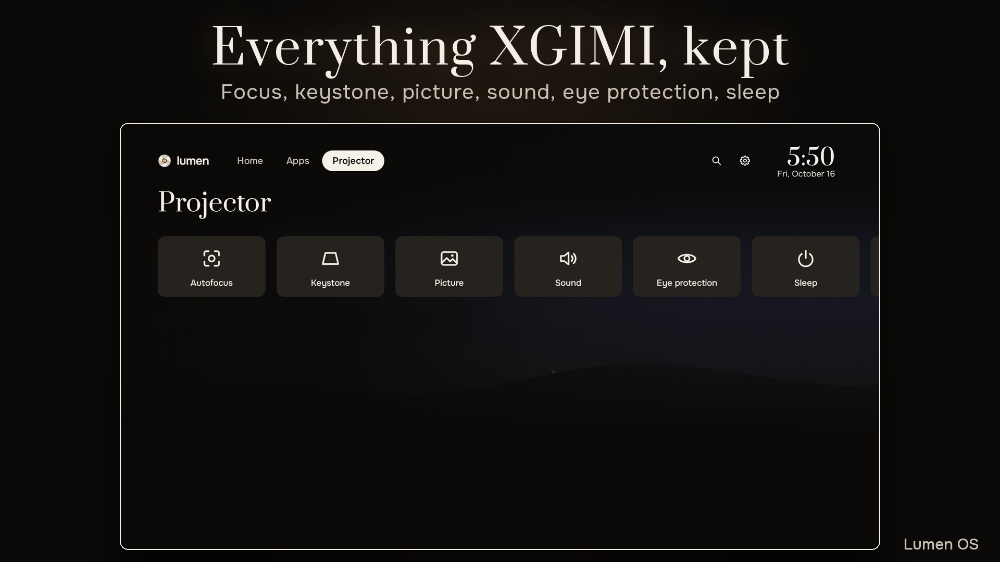
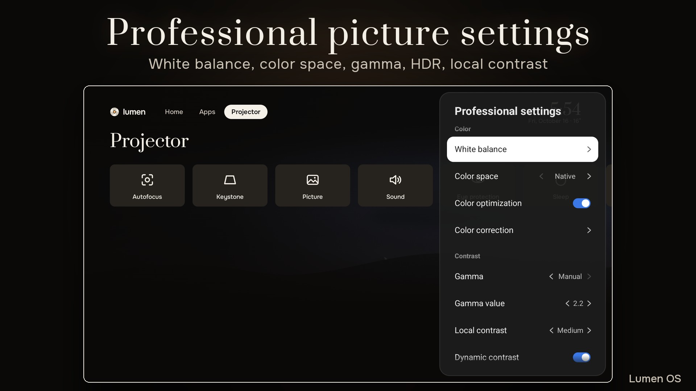
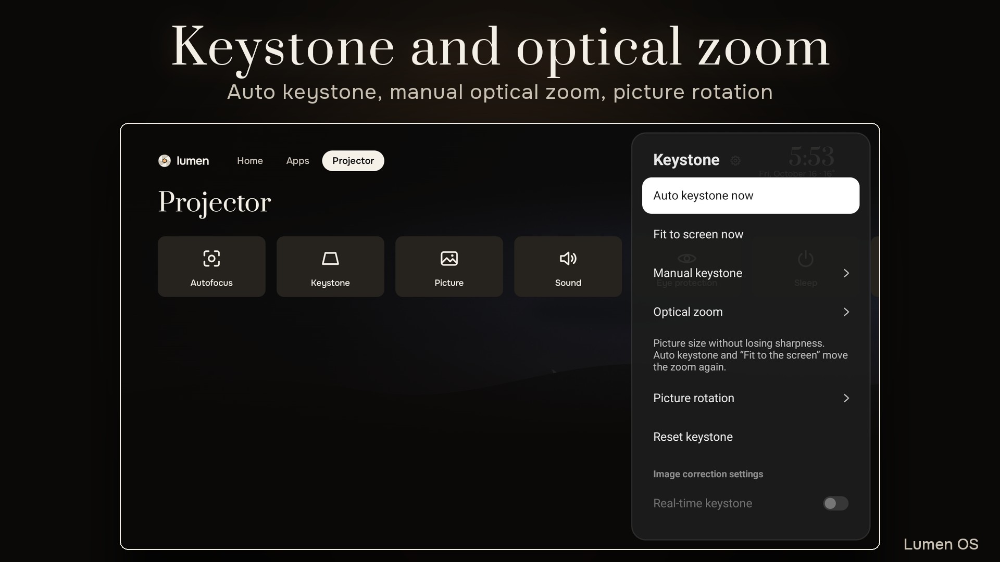
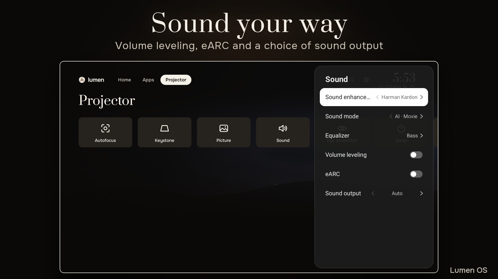
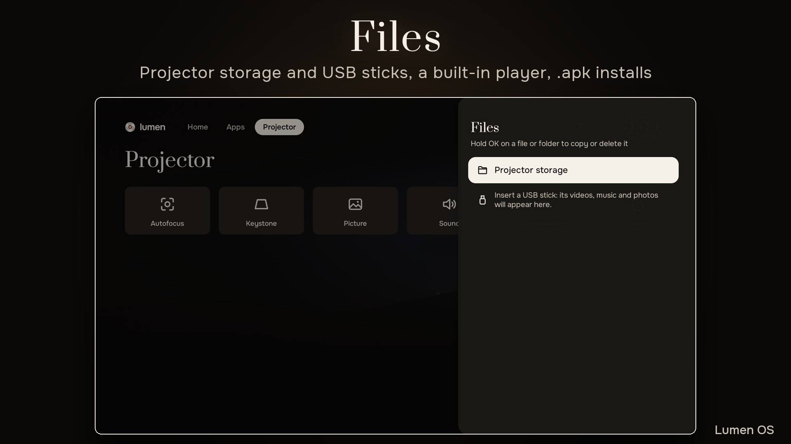
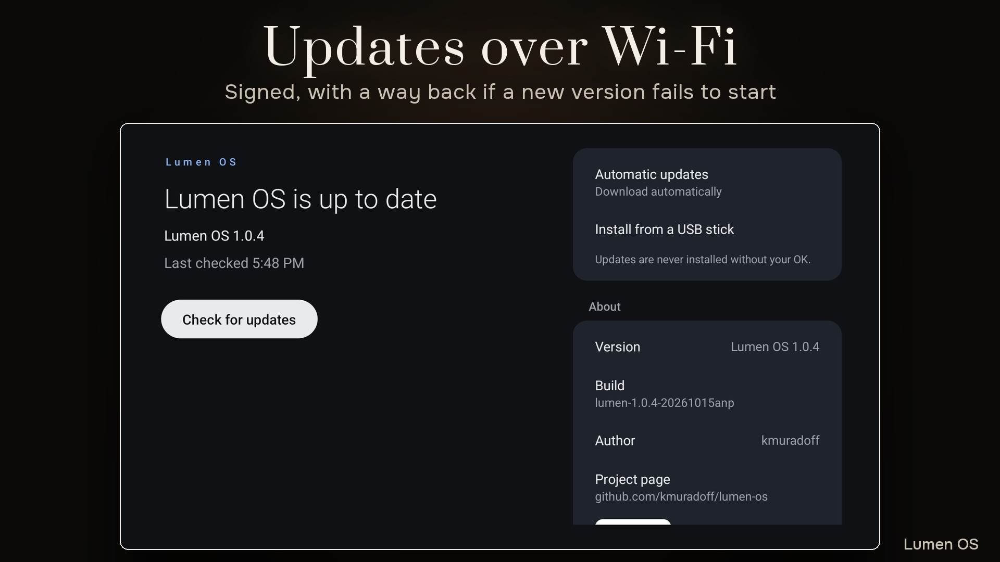

# Lumen OS

English | [Русский](README.ru.md)

Android TV 14 for XGIMI projectors, built on LineageOS 21.

## Supported projectors

| Projector | Status | Latest release | Install guide |
|---|---|---|---|
| XGIMI Z9X | stable | [Lumen OS 1.0.7](https://github.com/kmuradoff/lumen-os/releases/tag/v1.0.7) | [English](docs/install/z9x/en.md), [Русский](docs/install/z9x/ru.md) |
| XGIMI Play 6 | stable | [Lumen OS 1.0.7 for the Play 6](https://github.com/kmuradoff/lumen-os/releases/tag/play6-1.0.7) | [English](docs/install/play6/en.md), [Русский](docs/install/play6/ru.md) |

Each projector has its own release files, signed with its own key. The installer refuses an image for
another projector and any XGIMI firmware it does not know.

- XGIMI Z9X (model code G0082): XGIMI firmware V6.15.58, V6.15.62 or V6.15.19. Updates come over Wi-Fi.
- XGIMI Play 6 (model code G0058): XGIMI firmware V1.7.116, no other version. The newer V1.8.x (newer units with
  another Wi-Fi chip) is not supported yet: do not replace it with V1.7.116, Wi-Fi and Bluetooth then stop
  working. A new version goes on with the installer over the USB cable and
  keeps your data. Updates over Wi-Fi come later.
- XGIMI Play 6: Google services are not in the image and cannot be added yet. As on the Z9X, they are
  planned as an add-on that you make from your own MindTheGapps download.

More projectors will come later.

<p>






</p>

## What it is

Lumen OS replaces only the system partition of the projector. XGIMI's vendor firmware, boot, calibration,
lamp, focus and keystone stay as they are, and our apps drive them through XGIMI's own hardware service.
On the Z9X the interface runs at 1080p.

- Lumen Home: a clock over a live sky with the real sun and moon for your city (also the screensaver),
  weather, Continue watching from your installed apps, and all apps with favourites and A to Z.
- Projector app: autofocus, manual and auto keystone, picture and sound modes, eye protection, sleep,
  and a quick panel.
- Real sleep: the lamp goes off at once and the projector suspends. The remote wakes it in the same app.
- AirPlay receiver.
- 17 languages. The XGIMI remote pairs in the first setup.
- Updates over Wi-Fi, signed with the project's key. If a new version fails to start, the projector
  goes back to the previous one.
- Files: the projector's storage and USB sticks, a built-in player, and any `.apk` installs from there.
- No ads and no Google services running in the background. At most 10 apps are kept cached.

This list is for the Z9X. The Play 6 has Lumen Home, its own projector app with every stock setting, the HDMI
input, the voice assistant and the first setup, but no AirPlay receiver, no updates over Wi-Fi and no Google
services yet.

Nothing about you is collected. The system goes online only for the time zone and city (ip-api.com over
plain HTTP, ipapi.co or ipwho.is), the weather (Open-Meteo) and updates (GitHub).

## Without Google

The published edition has no Google apps: no Google Play, no Chromecast built-in, no Google voice
search. Apps that need Google Play services will not run. Apps install from a USB stick or from any store
you choose. You can add Google services yourself from your own MindTheGapps download: together with the
install in one command, or later with the installer's `gapps` step. See the Google part of the guide for
the [Z9X](docs/install/z9x/en.md#google) or the [Play 6](docs/install/play6/en.md#play6-google).

## Install

You need a computer with macOS or Linux (or Windows, in beta), Android Platform-Tools 35 or newer and a
USB A-to-A cable. The install erases all data on the projector. On the Z9X the cable goes into the
projector's USB 2.0 port, and there is one vbmeta step that you do by hand. The Play 6 talks to the
computer over Wi-Fi and needs the cable only for the write itself.

- Install guide: [XGIMI Z9X](docs/install/z9x/en.md), [XGIMI Play 6](docs/install/play6/en.md)
- Инструкция по установке: [XGIMI Z9X](docs/install/z9x/ru.md), [XGIMI Play 6](docs/install/play6/ru.md)

Download only from this repository's [Releases](https://github.com/kmuradoff/lumen-os/releases). The
release marked Latest is for the Z9X. The Play 6 release has a tag that starts with `play6-`. Every release has `SHA256SUMS` and `SHA256SUMS.sig`; the installer checks both and
refuses anything else. Copies on forums and file hosts are not ours.

## Updates and going back

On the Z9X, Lumen OS updates itself over Wi-Fi from Settings > Device Preferences > About > Lumen OS
update. An update installs into the other slot, keeps your data and waits for your OK. See
[Updates](docs/install/z9x/en.md#updates) and [CHANGELOG.md](CHANGELOG.md).

On the Play 6 there are no updates over Wi-Fi yet. Download the new Play 6 release and run
`bash lumen-install.sh --ip ADDRESS --keep-data flash`. It writes the new system over the USB cable and
keeps your data. Debugging must be on, see [step 6 of the Play 6 guide](docs/install/play6/en.md#play6-verify).

To go back, flash the official XGIMI firmware from a USB stick. This erases everything, see Back to stock
for the [Z9X](docs/install/z9x/en.md#stock) and for the [Play 6](docs/install/play6/en.md#play6-stock).

## Known issues

- The Windows installer has not been tested yet.
- On the Z9X, while a USB cable to a computer is connected, the projector does not really sleep. Unplug
  it after the install.
- HDMI-CEC has not been tested on the Z9X.
- The built-in keyboard types English; Lumen Home's search has its own keyboard.
- Once a new version has started, an update cannot be undone over the air.
- Play 6: no updates over Wi-Fi, no AirPlay receiver and no Google services yet.
- Play 6: while the A-to-A cable is in, the projector does not start. Unplug it right after the write,
  when the installer says so.
- Play 6: after failed starts Lumen OS does not go to fastboot mode by itself yet. If it does not start,
  the stock restore from a USB stick is the way back.

## Help and bug reports

Open an [issue](https://github.com/kmuradoff/lumen-os/issues) and include the projector model, the XGIMI
firmware version, the Lumen OS version (Settings > Device Preferences > About), what you did right before
the problem and the full installer output. Russian-speaking users also talk about Lumen OS in the
[XGIMI Z9X thread on 4PDA](https://4pda.to/forum/index.php?showtopic=1121837).

## Kino player

The video player made for Lumen OS lives in its own repository:
[kmuradoff/kino-player](https://github.com/kmuradoff/kino-player).

## Build

Lumen OS is put together from a LineageOS 21 TV GSI, our apps (`apps/`), system files (`system/`) and
the image tools (`tools/`). You can build all of it yourself, from the pinned LineageOS source to the
signed image, with your own keys: [docs/selfbuild](docs/selfbuild/en.md). That guide covers the Z9X. The
Play 6 build scripts are in `tools/play6` and `lineage/patches/play6`, without a step-by-step guide yet.
Notes for maintainers are in [docs/dev](docs/dev/README.md).

```
git clone --recurse-submodules https://github.com/kmuradoff/lumen-os.git
```

## Thanks

Special thanks to [@Avalone-s](https://github.com/Avalone-s) and [@SAAndrevv](https://github.com/SAAndrevv),
who helped make this project happen.

To the LineageOS, UxPlay, android-airplay-server and MindTheGapps projects, and to everyone who tests
Lumen OS and reports back.

## Support the project

Lumen OS is free and open source. If it is useful to you, you can support the work by card or in crypto.

Card (Russian bank cards and SBP): [pay.cloudtips.ru/p/723aaba1](https://pay.cloudtips.ru/p/723aaba1)

| Network | Address | QR |
|---|---|---|
| USDT on TRON (TRC20) only | `TRjBAWuPa7WjdsATNkgwy955imhobH6sQV` |  |
| TON, and USDT on TON | `UQA2yAApJyyZ_vOYwrM6E0K2hwmn_35Y7m68UbCN6Y_A1L6x` |  |

Check the network before you send. USDT sent to the TRON address over another network (ERC20, BEP20) is lost.

Thank you.

## License

Apache License 2.0, except `apps/Z9xAirPlay` (GPL-3.0-only) and the third-party submodules under
`apps/third_party`, which keep their own licenses. See [LICENSE](LICENSE) and [NOTICE](NOTICE). This
repository holds no Google apps, no MediaTek or XGIMI files and no signing keys.

Lumen OS is an independent project by kmuradoff. It is not affiliated with XGIMI, Google, MediaTek or
the LineageOS project. "XGIMI", "Android", "Google" and "LineageOS" are trademarks of their owners.
