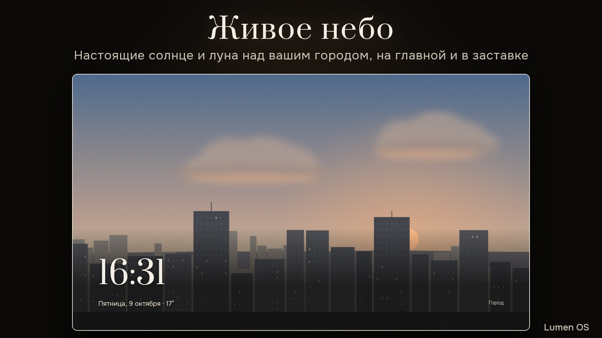
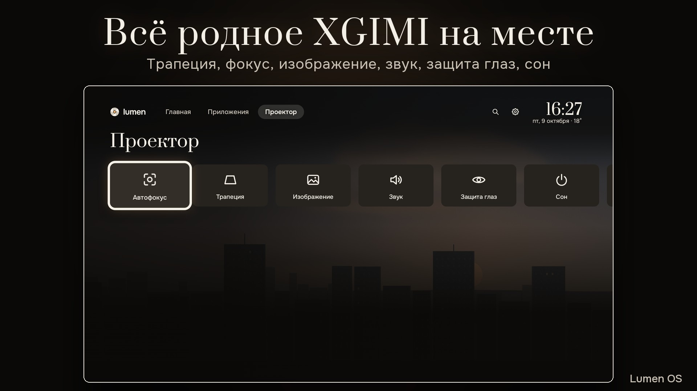
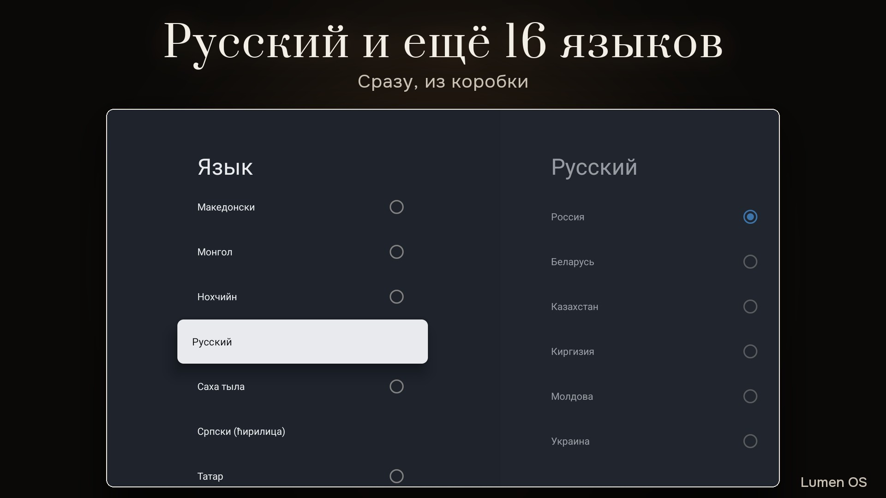
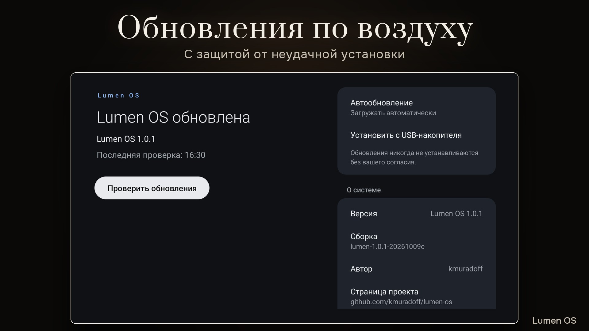

# Lumen OS

[English](README.md) | Русский

Android TV 14 для проекторов XGIMI на основе LineageOS 21.

## Какие проекторы подходят

| Проектор | Состояние | Последний релиз | Инструкция |
|---|---|---|---|
| XGIMI Z9X | стабильная | [Lumen OS 1.0.3](https://github.com/kmuradoff/lumen-os/releases/tag/v1.0.3) | [Русский](docs/install/ru.md), [English](docs/install/en.md) |
| XGIMI Play 6 | бета | [Play 6, бета 1](https://github.com/kmuradoff/lumen-os/releases/tag/play6-beta1) (Pre-release) | [Русский](docs/install/ru.md#play6), [English](docs/install/en.md#play6) |

У каждого проектора свои файлы релиза, подписанные своим ключом. Установщик не примет образ для другого
проектора и прошивку XGIMI, которую он не знает.

- XGIMI Z9X (модель G0082): прошивка XGIMI V6.15.58, V6.15.62 или V6.15.19. Обновления приходят по Wi-Fi.
- XGIMI Play 6 (модель G0058): прошивка XGIMI V1.7.116, другие версии не подходят. Это бета: ставьте,
  если готовы тестировать и писать о проблемах. Новая версия ставится установщиком по кабелю USB, данные
  сохраняются. Обновления по Wi-Fi появятся позже.
- XGIMI Play 6: сервисов Google в образе нет, и добавить их пока нельзя. Как и на Z9X, их планируется
  ставить отдельным дополнением, которое вы делаете сами из своего файла MindTheGapps.

Другие проекторы добавятся позже.

<p>




</p>

## Что это

Lumen OS заменяет на проекторе только системный раздел. Прошивка XGIMI, boot, калибровка, лампа, фокус и
трапеция остаются как были, а приложения Lumen OS управляют ими через родную службу XGIMI. На Z9X
интерфейс работает в 1080p.

- Lumen Home: часы на фоне живого неба с настоящими солнцем и луной для вашего города (оно же
  заставка), погода, «Продолжить просмотр» из установленных приложений, все приложения с избранным и
  по алфавиту.
- Приложение «Проектор»: автофокус, ручная и автоматическая трапеция, режимы изображения и звука,
  защита глаз, сон, быстрая панель.
- Настоящий сон: лампа гаснет сразу, проектор засыпает. Пульт будит его в том же приложении.
- Приёмник AirPlay.
- 17 языков, русский в том числе. Пульт XGIMI подключается в первой настройке.
- Обновления по Wi-Fi, подписанные ключом проекта. Если новая версия не загрузится, проектор вернётся
  к прежней.
- «Установить с USB»: любой `.apk` с флешки прямо из Lumen Home.
- Нет рекламы и фоновых сервисов Google. В фоне держится не больше 10 приложений.

Этот список для Z9X. В бете для Play 6 есть Lumen Home, своё приложение «Проектор», вход HDMI и первая
настройка, но пока нет приёмника AirPlay, обновлений по Wi-Fi и сервисов Google.

Аккаунт для Lumen OS не нужен, данные о вас не собираются. В сеть система ходит только за часовым
поясом и городом (ip-api.com без шифрования, ipapi.co или ipwho.is), погодой (Open-Meteo) и
обновлениями (GitHub).

## Без Google

В опубликованной версии нет приложений Google: Google Play, Chromecast built-in, голосового поиска
Google. Не запустятся приложения, которым нужны сервисы Google Play. Приложения ставятся с флешки или из
любого магазина, который вы выберете. Сервисы Google можно добавить самому одной командой установщика из
своего файла MindTheGapps, см. [«Как поставить сервисы Google»](docs/install/ru.md#google). Пока это
работает только на Z9X.

## Установка

Нужны компьютер с macOS или Linux (или Windows, пока в бета-режиме), Android Platform-Tools 35 или
новее и кабель USB A–A. Установка стирает все данные на проекторе. На Z9X кабель идёт в порт USB 2.0
проектора, и есть один шаг vbmeta, который вы делаете руками. Play 6 связывается с компьютером по Wi-Fi,
а кабель нужен только для самой записи.

- [Инструкция по установке](docs/install/ru.md), для Play 6 [свой раздел](docs/install/ru.md#play6)
- [Install guide (English)](docs/install/en.md), the Play 6 has [its own part](docs/install/en.md#play6)

Скачивайте только со [страницы релизов](https://github.com/kmuradoff/lumen-os/releases) этого
репозитория. Релиз с пометкой «Latest» для Z9X. Тег релиза для Play 6 начинается с `play6-`, и релиз
помечен как Pre-release. В каждом релизе есть `SHA256SUMS` и `SHA256SUMS.sig`, установщик проверяет оба
и другой образ не примет. Копии на форумах и файлообменниках я не проверяю.

## Обновления и откат

На Z9X Lumen OS обновляется по Wi-Fi: «Настройки → Настройки устройства → Об устройстве → Обновление
Lumen OS». Обновление ставится во второй слот, сохраняет данные и ждёт вашего согласия. Подробнее в
разделе [«Обновления»](docs/install/ru.md#updates), список изменений в [CHANGELOG.md](CHANGELOG.md).

На Play 6 обновлений по Wi-Fi пока нет. Скачайте новый релиз для Play 6 и запустите
`bash lumen-install.sh --ip АДРЕС --keep-data flash`. Установщик запишет новую систему по кабелю USB и
сохранит данные. Отладка должна быть включена, см. [шаг 6 для Play 6](docs/install/ru.md#play6-verify).

Вернуться на родную прошивку можно официальной прошивкой XGIMI с флешки. Это стирает всё, см. «Откат на
сток» для [Z9X](docs/install/ru.md#stock) и для [Play 6](docs/install/ru.md#play6-stock).

## Известные проблемы

- Установщик для Windows ещё не проверялся.
- На Z9X, пока кабель USB подключён к компьютеру, проектор не засыпает по-настоящему. После установки
  отключите кабель.
- HDMI-CEC на Z9X не проверялся.
- Z9X, 1.0.3: в оптическом зуме число размера не меняется, а после нескольких шагов картинка может
  перестать меняться.
- Встроенная клавиатура печатает на английском. У поиска в Lumen Home своя клавиатура с кириллицей.
- Когда новая версия уже загрузилась, откатить обновление по воздуху нельзя.
- Play 6: пока нет обновлений по Wi-Fi, приёмника AirPlay и сервисов Google.
- Play 6: пока вставлен кабель A–A, проектор не загружается. Выньте кабель сразу после записи, когда
  скажет установщик.
- Play 6: после неудачных запусков Lumen OS пока не уходит в режим fastboot сама. Если она не
  загружается, вернуть проектор можно откатом на сток с флешки.

## Помощь и сообщения об ошибках

Пишите в [тему XGIMI Z9X на 4PDA](https://4pda.to/forum/index.php?showtopic=1121837) или в
[issues на GitHub](https://github.com/kmuradoff/lumen-os/issues). Укажите модель проектора, версию
прошивки XGIMI, версию Lumen OS («Настройки → Настройки устройства → Об устройстве») и что вы делали
перед проблемой, и приложите весь текст из терминала.

## Плеер «Кино»

Видеоплеер, который я сделал для Lumen OS, лежит в отдельном репозитории:
[kmuradoff/kino-player](https://github.com/kmuradoff/kino-player).

## Сборка

Lumen OS собирается из TV GSI LineageOS 21, приложений Lumen OS (`apps/`), системных файлов (`system/`) и
инструментов для образа (`tools/`). Всё это можно собрать самому, от исходников LineageOS в тех же
версиях до подписанного образа, своими ключами: [docs/selfbuild](docs/selfbuild/ru.md). Эта инструкция
для Z9X. Скрипты сборки для Play 6 лежат в `tools/play6` и `lineage/patches/play6`, пошаговой инструкции к
ним пока нет. Заметки для разработчиков лежат в [docs/dev](docs/dev/README.md).

```
git clone --recurse-submodules https://github.com/kmuradoff/lumen-os.git
```

## Благодарности

Спасибо проектам LineageOS, UxPlay, android-airplay-server и MindTheGapps, а также всем, кто
тестирует Lumen OS и пишет в теме на 4PDA.

## Поддержать проект

Lumen OS бесплатная, код открыт. Если она вам пригодилась, проект можно поддержать картой или криптой.

Картой (карты российских банков, СБП): [pay.cloudtips.ru/p/723aaba1](https://pay.cloudtips.ru/p/723aaba1)

| Сеть | Адрес | QR |
|---|---|---|
| USDT только в сети TRON (TRC20) | `TRjBAWuPa7WjdsATNkgwy955imhobH6sQV` |  |
| TON и USDT в сети TON | `UQA2yAApJyyZ_vOYwrM6E0K2hwmn_35Y7m68UbCN6Y_A1L6x` |  |

Проверьте сеть перед отправкой. USDT, отправленные на адрес TRON через другую сеть (ERC20, BEP20), пропадут.

Спасибо.

## Лицензия

Apache License 2.0, кроме `apps/Z9xAirPlay` (GPL-3.0-only) и сторонних подмодулей в `apps/third_party`
со своими лицензиями. Подробнее в [LICENSE](LICENSE) и [NOTICE](NOTICE). В репозитории нет приложений
Google, файлов MediaTek и XGIMI и ключей подписи.

Lumen OS я делаю сам. XGIMI, Google, MediaTek и LineageOS к ней отношения не имеют. Товарные знаки
XGIMI, Android, Google и LineageOS принадлежат их владельцам.
